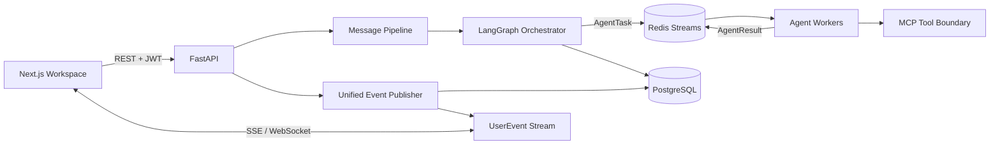

<div align="center">

# Nexis

### Event-Driven Multi-Agent Collaborative Workspace

**A collaborative group-chat platform where autonomous agents, skills, MCP tools, human approvals, and durable event delivery operate behind explicit task contracts.**

`LangGraph` · `FastAPI` · `Next.js 15` · `MCP` · `Redis Streams` · `PostgreSQL` · `SSE / WebSocket`

[Full Technical README](../README.md) · [Getting Started](../GETTING_STARTED.md) · [Production Notes](../deploy/production/README.md)

</div>

---

## Why Nexis Matters

Nexis is designed for **production-grade multi-agent collaboration**. Instead of fragmented chatbots or brittle chains, it provides:
- **Explicit Task & Result Contracts**: Decoupled agent workers communicate asynchronously over Redis Streams.
- **Master Orchestrator**: LangGraph state machine manages task breakdown, state transitions, and checkpoints.
- **Model Context Protocol (MCP)**: Strict tool boundary isolating search, browser, file, and media processing.
- **Human-in-the-Loop (HITL)**: Interactive approval cards pause high-cost actions for explicit user sign-off.
- **Durable Event Replay**: PostgreSQL event log and SSE `Last-Event-ID` protocol enable seamless reconnection without lost messages.

---

## Core Architecture



---

## Capabilities Matrix

| Capability | Implementation |
|---|---|
| **Agent Interaction** | Main team chat, 1-on-1 private agent chat, `@Agent` mentions, Plan / Ask / Auto execution modes |
| **Orchestration** | LangGraph orchestration backbone with `AgentTask` / `AgentResult` Redis schemas |
| **Worker Transport** | Redis Streams asynchronous task bus |
| **Tool Integration** | Standardized MCP (Model Context Protocol) service boundaries |
| **Skills Engine** | Declarative YAML skills with validation, permission scoping, and lifecycle toggles |
| **Human Control** | Interactive HITL cards, task step tracking, artifact previews, and agent status panels |
| **Event Persistence** | PostgreSQL persistence, Redis Pub/Sub broadcast, and local in-process fallback |
| **Reconnection** | Stable event IDs, `Last-Event-ID` tracking, frontend deduplication, and durable SSE replay |
| **API Contracts** | OpenAPI-generated TypeScript client types with automated contract validation |

---

## Quickstart

Requirements: **Python 3.12+**, **uv**, **Node 20+**, **pnpm 9.15.9**, **Docker Compose**.

```powershell
.\scripts\core.ps1 setup
.\scripts\core.ps1 start
.\scripts\core.ps1 status
```

For environment configurations, deployment guides, and API schemas, see the **[main README](../README.md)**.
