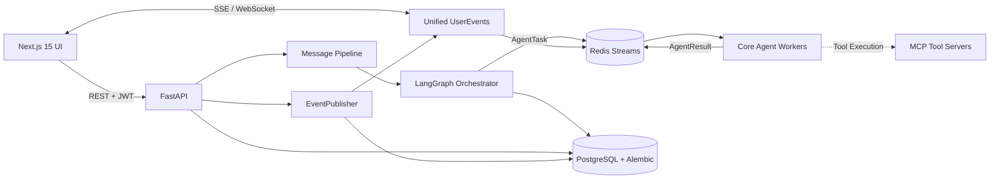

# Nexis

> **Nexis** is an event-driven multi-agent collaborative workspace that unifies chat-based multi-agent interaction, LangGraph master orchestration, Redis Streams task queues, Model Context Protocol (MCP) tools, durable SSE replay, and Human-in-the-Loop (HITL) workflows.

Nexis supports zero-key development and testing out of the box using `LITELLM_MOCK=true`. Real LLMs, SMS authentication, S3-compatible object storage, and cloud publishing services can be configured in your environment as needed.

---

## Key Features

- **Multi-Agent Collaboration**: Work with specialized AI agents in a shared group chat or open 1-on-1 private channels while retaining synchronized project context.
- **Master Orchestrator**: LangGraph-powered coordinator that parses intent, matches skills, plans tasks, and dispatches sub-tasks to workers via Redis Streams.
- **Specialized Worker Agents**: Dedicated workers for copywriting, document processing, visual asset generation, and background audio/video compilation (Celery).
- **Execution Modes**:
  - `Ask`: Clarifies ambiguous user requirements before execution.
  - `Plan`: Generates a structured multi-step execution plan for human review.
  - `Auto`: Autonomously executes tasks in parallel with live status reporting.
- **Human-in-the-Loop (HITL)**: Built-in approval gates for high-cost actions (e.g., batch image generation, video rendering, publishing).
- **Extensible Skill Market**: Modular YAML playbook definitions with parameter validation, permission checks, and lifecycle management (install/enable/disable).
- **Resilient Event Architecture**: Unified `UserEvent` pipeline with PostgreSQL persistence, Redis Pub/Sub broadcast, in-process fallback, and SSE with `Last-Event-ID` auto-reconnect and replay.
- **Modern Full-Stack Experience**: Next.js 15 frontend, Tailwind CSS, TanStack Query, generated OpenAPI TypeScript types, and mobile-responsive drawer navigation.

---

## Architecture



The business layer communicates exclusively through the unified `EventPublisher`. The frontend does not execute agent logic directly; it handles API requests, state rendering, HITL confirmation cards, and real-time SSE stream consumption.

---

## Repository Structure

```text
backend/                    FastAPI API, SQLAlchemy models, Alembic migrations, skills, unit tests
agents/agents/              LangGraph master orchestrator and worker agent implementations
agents/mcp_servers/         Model Context Protocol (MCP) tool servers (search, vision, audio/video)
frontend/                   Next.js 15 frontend, TanStack Query, Vitest, Playwright E2E tests
backend/infrastructure/     Docker Compose configurations (PostgreSQL, Redis, MinIO, Qdrant)
compose.core.yml            Minimal local development stack (PostgreSQL + Redis)
deploy/production/          Production Dockerfiles, Compose stacks, and Kubernetes manifests
scripts/                    Lifecycle automation and development management scripts (core.ps1)
test/                       Cross-agent integration and workflow test suites
.github/workflows/          Automated CI/CD pipeline and code quality validation
```

---

## Quickstart

### Prerequisites
- Python 3.12+
- `uv` (fast Python package manager)
- Node.js 20+ & `pnpm` 9.15.9+
- Docker Compose

### Starting Locally

```powershell
.\scripts\core.ps1 setup
.\scripts\core.ps1 start
.\scripts\core.ps1 status
```

The setup script provisions core databases in Docker, installs dependencies, runs database migrations, and starts the services:
- **Frontend**: `http://localhost:3000` (auto-logs into a local guest session)
- **Backend API**: `http://localhost:8001` (interactive docs at `/docs`)

---

## Development Modes

### Mock Mode (Default)
By default, the root `.env.example` includes:

```dotenv
LITELLM_MOCK=true
SMS_DEV_MODE=true
```

Development verification code is fixed to `123456`. Frontend mock mode can be toggled explicitly:

```powershell
$env:NEXT_PUBLIC_MOCK_MODE='true'
pnpm dev
```

### Production Mode
Set `LITELLM_MOCK=false` and configure your LiteLLM Proxy or direct provider API keys (OpenAI, Anthropic, DeepSeek, etc.). Configure production SMS credentials (`SMS_DEV_MODE=false`), object storage bucket credentials, and secret tokens in `.env`.

---

## Environment Variables

| Group | Key Variables |
| :--- | :--- |
| **Runtime** | `ENV`, `DEBUG`, `LOG_LEVEL` |
| **Data Stores** | `DATABASE_URL`, `REDIS_URL`, `CELERY_BROKER_URL`, `CELERY_RESULT_BACKEND` |
| **Security & Auth** | `JWT_SECRET`, `JWT_EXPIRE_HOURS`, `SMS_DEV_MODE`, `SMS_OTP_TTL_SECONDS`, `LOCAL_GUEST_ACCESS` |
| **Event Streaming** | `SSE_HEARTBEAT_SECONDS`, `WS_HEARTBEAT_SECONDS`, `CORS_ORIGINS` |
| **Model Gateway** | `LITELLM_URL`, `LITELLM_API_KEY`, `LITELLM_MOCK` |
| **Tools (MCP)** | `MCP_SEARCH_URL`, `MCP_IMAGE_TOOLS_URL`, `MCP_VIDEO_TOOLS_URL`, `MCP_AUDIO_TOOLS_URL`, `MCP_DOCUMENT_TOOLS_URL` |
| **Storage** | `OSS_ENDPOINT`, `OSS_BUCKET`, `OSS_ACCESS_KEY`, `OSS_SECRET_KEY` |
| **Frontend** | `NEXT_PUBLIC_API_URL`, `NEXT_PUBLIC_MOCK_MODE`, `NEXT_PUBLIC_LOCAL_GUEST_ACCESS` |

---

## Database Migrations

Database schema is strictly managed via Alembic:

```powershell
Push-Location backend
..\.venv\Scripts\alembic.exe upgrade head
..\.venv\Scripts\python.exe scripts/bootstrap-skills.py
Pop-Location
```

---

## API & Streaming Protocol

- **Conversation Messages**: `GET /api/conversations/{id}/messages`
- **Post Message**: `POST /api/conversations/{id}/messages`
- **Real-Time SSE Stream**: `GET /api/conversations/{id}/events`
- **Skill Marketplace**: `GET /api/skills`, `/api/skills/{id}/install`, `/api/skills/{id}/enable`
- **Authentication**: `POST /api/auth/sms/send`, `POST /api/auth/login`

SSE connections use `Authorization: Bearer <jwt>` and include the `Last-Event-ID` header on reconnect. OpenAPI specifications automatically generate frontend types in `frontend/lib/api-types.ts`.

---

## Testing & Quality Assurance

```powershell
# Python linting and unit tests
.\.venv\Scripts\ruff.exe check backend agents
.\.venv\Scripts\python.exe -m pytest backend/tests -q
.\.venv\Scripts\python.exe -m pytest agents/tests test/test_agent_task_handlers.py -q

# Frontend checks and tests
Set-Location frontend
pnpm lint
pnpm typecheck
pnpm test
pnpm build
```

---

## License & Contributing

- **License**: [LICENSE](LICENSE) (MIT License)
- **Third-Party Notices**: [THIRD_PARTY_NOTICES.md](THIRD_PARTY_NOTICES.md)
- **Contributing**: Please review [CONTRIBUTING.md](CONTRIBUTING.md)
